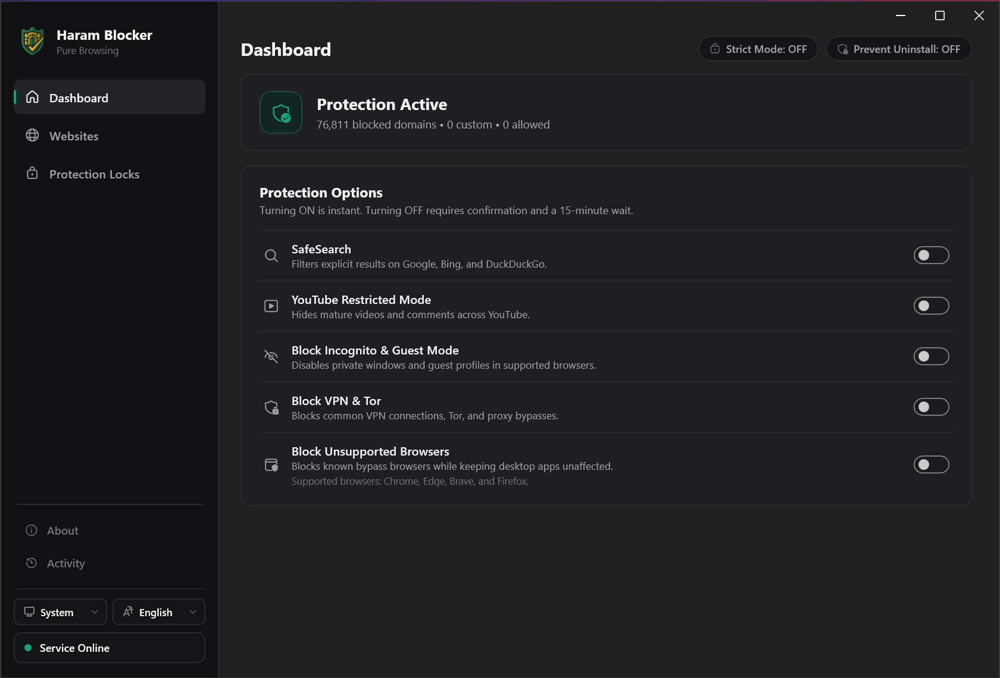
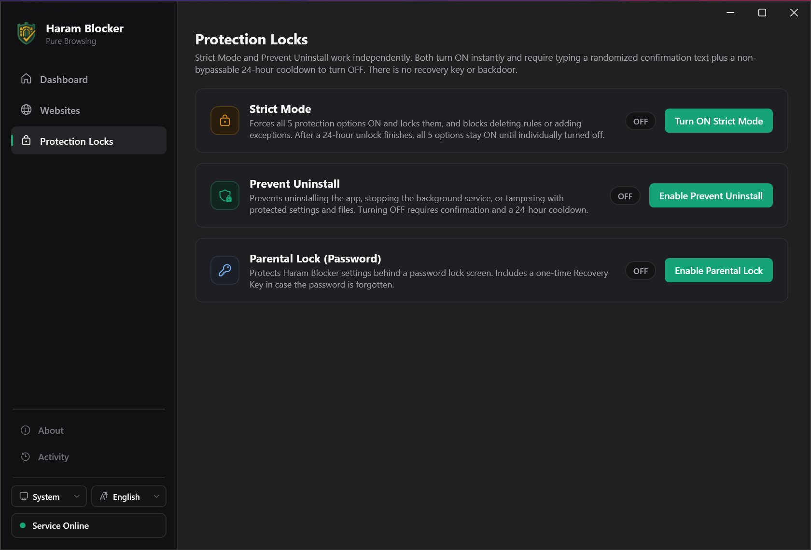

  
  
<strong>Pure Browsing — System-Wide Content Filtering & Protection for Windows</strong>

  

    
    
  

  

    <a href="#english"><strong>English</strong></a> | <a href="#arabic"><strong>العربية</strong></a>
  

---

## Screenshots

  
    
  
    
  

---

## Overview

**Haram Blocker** is a lightweight, system-wide Windows desktop application designed to enforce clean, distraction-free, and safe browsing across all browsers and apps. It runs as a protected background Windows Service with a modern Windows 11 Fluent UI and strong anti-tampering locks.

### Download & Installation

1. Go to the [**Latest Release**](https://github.com/agaabdelgawad/HaramBlocker/releases/latest) page.
2. Download **`HaramBlocker.msi`** from the **Assets** section.
3. Run the installer as **Administrator** and follow the setup wizard.

**Requirements:** Windows 10 or Windows 11 (64-bit).

### Key Features

- **System-Wide DNS Filtering:** Blocks adult and harmful domains across all browsers and applications with automated background blocklist updates.
- **Custom Website Rules:** Easily add manually blocked domains or allow specific exceptions (Whitelist).
- **Protection Options:** All 5 options start **OFF** by default and turn **ON** instantly; turning any option **OFF** requires randomized confirmation text + a **15-minute cooldown**:
  - **SafeSearch Enforcement** (Google, Bing, DuckDuckGo)
  - **YouTube Restricted Mode**
  - **Block Incognito & Guest Mode**
  - **Block VPN & Tor**
  - **Block Unsupported Browsers**
- **Protection Locks:**
  - **Strict Mode:** Forces all 5 protection options ON, locks them, and blocks deleting rules or adding exceptions (requires confirmation + non-bypassable **24-hour cooldown** to disable).
  - **Prevent Uninstall:** Blocks uninstalling the app, stopping the background service, or tampering with protected settings/files (**24-hour cooldown** to disable).
  - **Parental Lock (Password):** Protects the app interface behind a password lock screen (stored via salted PBKDF2 hashing) with a one-time **Recovery Key**.
- **Native Windows 11 Experience:** Dark/Light/System themes, full **English & Arabic (RTL)** support, System Tray integration, Activity Log, and a built-in **Update Checker**.

### Support & Feedback

- **Found a bug or have a feature suggestion?** [Open an Issue](https://github.com/agaabdelgawad/HaramBlocker/issues) on GitHub.

---

## نظرة عامة

**Haram Blocker** هو برنامج خفيف ومجاني لنظام ويندوز يعمل على مستوى النظام بالكامل لتوفير تصفح آمن ونقي عبر جميع المتصفحات والتطبيقات. يعمل البرنامج عبر خدمة خلفية محمية (`Windows Service`) مع واجهة حديثة بتصميم ويندوز 11 وآليات قوية لمنع التلاعب أو الإيقاف المتسرع.

### التحميل والتثبيت

1. انتقل إلى صفحة [**آخر إصدار (Latest Release)**](https://github.com/agaabdelgawad/HaramBlocker/releases/latest).
2. حمّل ملف **`HaramBlocker.msi`** من قسم **Assets**.
3. شغّل ملف التثبيت بصلاحيات المسؤول (**Administrator**) واتبع خطوات المعالج.

**المتطلبات:** ويندوز 10 أو ويندوز 11 (نواة 64-bit).

### المميزات الرئيسية

- **حجب DNS على مستوى النظام بالكامل:** حجب المواقع الإباحية والضارة عبر جميع المتصفحات والتطبيقات مع تحديث تلقائي لقوائم الحجب في الخلفية.
- **إدارة المواقع المخصصة:** إضافة مواقع محجوبة يدويًا أو إدارة قائمة الاستثناءات (`Whitelist`).
- **خيارات الحماية (`Protection Options`):** تبدأ جميع الخيارات الخمسة متوقفة افتراضيًا وتُفعّل **فوريًا** بضغطة واحدة، بينما يتطلب إيقاف أي منها كتابة نص تأكيد عشوائي والانتظار لمدة **15 دقيقة**:
  - **البحث الآمن (`SafeSearch`)** على Google وBing وDuckDuckGo.
  - **وضع تقييد يوتيوب (`YouTube Restricted Mode`).**
  - **منع التصفح المتخفي والضيف (`Incognito & Guest Mode`).**
  - **منع `VPN` و`Tor`.**
  - **منع المتصفحات غير المدعومة.**
- **أقفال الحماية (`Protection Locks`):**
  - **الوضع الصارم (`Strict Mode`):** يفعّل ويقفل خيارات الحماية الخمسة ويمنع حذف القواعد أو إضافة استثناءات (يتطلب إيقافه نص تأكيد + مهلة **24 ساعة** غير قابلة للتجاوز).
  - **منع إزالة البرنامج (`Prevent Uninstall`):** يمنع حذف البرنامج أو إيقاف الخدمة الخلفية أو التلاعب بالملفات المحمية (مهلة **24 ساعة** للإيقاف).
  - **القفل الأبوي (`Parental Lock`):** حماية واجهة البرنامج بكلمة مرور مشفرة مع **مفتاح استرداد لمرة واحدة (`Recovery Key`)**.
- **تجربة ويندوز 11 أصلية:** يدعم الوضع الداكن والفاتح وتلقائي النظام، اللغتين العربية (`RTL`) والإنجليزية، أيقونة `System Tray`، سجل النشاط (`Activity Log`)، و**فاحص تحديثات مدمج**.

### الدعم والاقتراحات

- **هل واجهت مشكلة أو لديك اقتراح لميزة جديدة؟** يمكنك فتح تذكرة مباشرة عبر صفحة [**GitHub Issues**](https://github.com/agaabdelgawad/HaramBlocker/issues).

