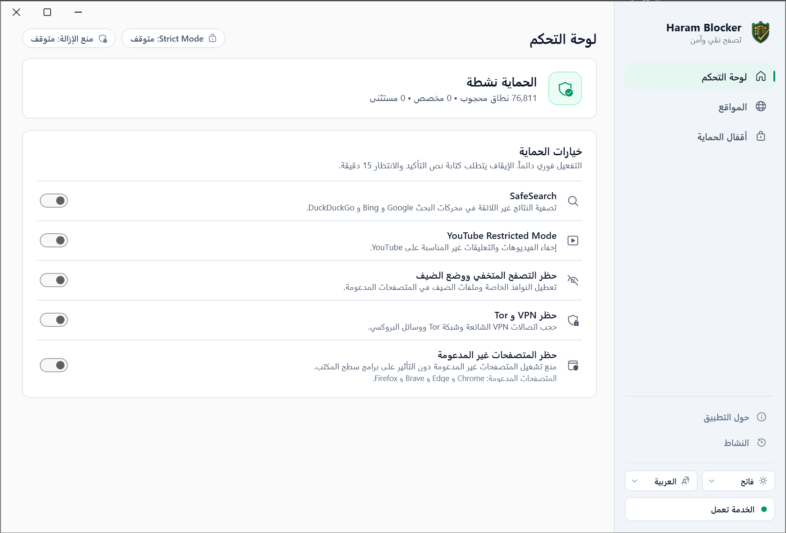

  
  
<strong>Pure Browsing — System-Wide Adult & Haram Content Blocker for Windows</strong>

  

    
    
  

  

    <a href="#english"><strong>English</strong></a> | <a href="#arabic"><strong>العربية</strong></a>
  

---

## Screenshots

  
    
  
    
  

---

## Overview

**Haram Blocker** is a lightweight, free, system-wide Windows desktop application specifically built to **block adult, pornographic, and Haram content** across all browsers and applications. It runs as a protected background Windows Service with a modern Windows 11 Fluent UI and strong **anti-relapse cooldowns and anti-tampering locks** designed to prevent quick bypassing or hasty disabling.

### Download & Installation

1. Go to the [**Latest Release**](https://github.com/agaabdelgawad/HaramBlocker/releases/latest) page.
2. Download **`HaramBlocker.msi`** from the **Assets** section.
3. Run the installer as **Administrator** and follow the setup wizard.

> **Note (Windows SmartScreen):** Because this installer is not yet digitally signed with a paid certificate, Windows may display a *"Windows protected your PC"* warning on first run. Click **More info** → **Run anyway** to proceed safely.

> **Note (Other DNS / Filtering Apps):** To avoid DNS conflicts (Port 53), please disable or uninstall any other local DNS filtering apps (such as CleanBrowsing, NextDNS, or AdGuard) before running Haram Blocker.

**Requirements:** Windows 10 or Windows 11 (64-bit).

### Key Features

- **System-Wide Adult & Haram DNS Filtering:** Automatically blocks pornographic, adult, and harmful domains across all browsers and apps via a local DNS service, with automated background blocklist updates.
- **Custom Website Rules:** Easily add your own manually blocked domains or allow specific exceptions (**Whitelist**).
- **Protection Options (Instant ON / 15-Minute Cooldown OFF):**
  All 5 options start **OFF** by default and turn **ON** instantly with a single click:
  - **SafeSearch Enforcement** (Google, Bing, DuckDuckGo)
  - **YouTube Restricted Mode**
  - **Block Incognito & Guest Mode**
  - **Block VPN & Tor**
  - **Block Unsupported Browsers**
- **Protection Locks (24-Hour Anti-Tampering Cooldown):**
  - **Strict Mode:** Forces all 5 protection options **ON**, locks them from being disabled, and blocks deleting rules or adding whitelist exceptions.
  - **Prevent Uninstall:** Blocks uninstalling the app, stopping the background Windows Service, or tampering with protected settings and files.
  - **Parental Lock (Password):** Protects the entire app interface behind a password lock screen (secured with salted PBKDF2 hashing) and provides a one-time **Recovery Key**.
- **Native Windows 11 Experience:** Dark/Light/System themes, full **English & Arabic (RTL)** support, System Tray integration, Activity Log, and a built-in **Update Checker**.

### How Anti-Relapse Protection Works (15-Min & 24-Hour Cooldowns)

Most blockers fail because they can be turned off in seconds during a moment of weakness. **Haram Blocker** adds intentional friction to break impulsive relapse:

- **15-Minute Cooldown (Protection Options):** Turning off any individual protection option requires typing a randomized confirmation text, followed by a 15-minute waiting period.
- **24-Hour Cooldown (Strict Mode & Prevent Uninstall):** Disabling high-level locks requires confirmation plus a full 24-hour cooling-off period.
- **Protection Stays Active:** Blocking remains fully enforced throughout the entire countdown—nothing turns off until the timer finishes.
- **Cancel Anytime & Non-Bypassable:** If the urge passes, you can cancel the disable request immediately. Closing the app or restarting Windows will not bypass or shorten the timer.

### Support & Feedback

- **Found a bug or have a feature suggestion?** [Open an Issue](https://github.com/agaabdelgawad/HaramBlocker/issues) on GitHub.

---

## نظرة عامة

**Haram Blocker** هو برنامج خفيف ومجاني لنظام ويندوز مخصص **لحجب المواقع الإباحية والمحتوى الحرام والضار** على مستوى النظام بالكامل عبر جميع المتصفحات والتطبيقات. يعمل البرنامج عبر خدمة خلفية محمية (`Windows Service`) مع واجهة حديثة بتصميم ويندوز 11، و**مهل انتظار للحماية من الانتكاسة** وأقفال قوية **لمنع التلاعب أو الإيقاف المتسرع**.

### التحميل والتثبيت

1. انتقل إلى صفحة [**آخر إصدار (Latest Release)**](https://github.com/agaabdelgawad/HaramBlocker/releases/latest).
2. حمّل ملف **`HaramBlocker.msi`** من قسم **Assets**.
3. شغّل ملف التثبيت بصلاحيات المسؤول (**Administrator**) واتبع خطوات المعالج.

> **ملاحظة (`Windows SmartScreen`):** نظرًا لأن ملف التثبيت غير موقّع حاليًا بشهادة رقمية مدفوعة، قد يظهر تحذير ويندوز (*Windows protected your PC*) عند التشغيل لأول مرة. اضغط على **More info** (معلومات إضافية) ثم **Run anyway** (التشغيل على أي حال) للمتابعة بأمان.

> **ملاحظة (تعارض برامج الفلترة الأخرى):** لتجنب تعارض إعدادات الـ DNS، يُفضّل إيقاف أو إزالة أي برنامج فلترة DNS محلي آخر (مثل CleanBrowsing أو NextDNS أو AdGuard) قبل تشغيل Haram Blocker.

**المتطلبات:** ويندوز 10 أو ويندوز 11 (نواة 64-bit).

### المميزات الرئيسية

- **حجب المواقع الإباحية والحرام على مستوى النظام (DNS Filtering):** حجب تلقائي وشامل للمواقع الإباحية والضارة عبر جميع المتصفحات والتطبيقات، مع تحديث تلقائي لقوائم الحجب في الخلفية.
- **إدارة المواقع المخصصة:** إضافة مواقع محجوبة يدويًا بسهولة، أو إدارة قائمة الاستثناءات (`Whitelist`).
- **خيارات الحماية (`Protection Options`) — تفعيل فوري وإيقاف بمهلة 15 دقيقة:**
  تبدأ جميع الخيارات الخمسة متوقفة افتراضيًا وتُفعّل **فوريًا** بضغطة واحدة:
  - **البحث الآمن (`SafeSearch`)** على Google وBing وDuckDuckGo.
  - **وضع تقييد يوتيوب (`YouTube Restricted Mode`).**
  - **منع التصفح المتخفي والضيف (`Incognito & Guest Mode`).**
  - **منع `VPN` و`Tor`.**
  - **منع المتصفحات غير المدعومة.**
- **أقفال الحماية (`Protection Locks`) — مهلة 24 ساعة ضد التلاعب:**
  - **الوضع الصارم (`Strict Mode`):** يفعّل ويقفل خيارات الحماية الخمسة جميعها ويمنع حذف قواعد الحجب أو إضافة استثناءات.
  - **منع إزالة البرنامج (`Prevent Uninstall`):** يمنع حذف البرنامج أو إيقاف الخدمة الخلفية أو التلاعب بالإعدادات والملفات المحمية.
  - **القفل الأبوي (`Parental Lock`):** حماية واجهة البرنامج بالكامل بكلمة مرور مشفرة (`PBKDF2`) مع **مفتاح استرداد لمرة واحدة (`Recovery Key`)**.
- **تجربة ويندوز 11 أصلية:** يدعم الوضع الداكن والفاتح وتلقائي النظام، اللغتين العربية (`RTL`) والإنجليزية، أيقونة `System Tray`، سجل النشاط (`Activity Log`)، و**فاحص تحديثات مدمج**.

### كيف تعمل الحماية من الانتكاسة (مهلة 15 دقيقة و24 ساعة)؟

تفشل أغلب برامج الحجب لأن المستخدم يستطيع إيقافها في ثوانٍ أثناء لحظات الضعف. يعالج **Haram Blocker** ذلك عبر مهلة انتظار إلزامية تكسر الاندفاع اللحظي:

- **مهلة 15 دقيقة (لخيارات الحماية):** إيقاف أي خيار حماية منفرد يتطلب كتابة نص تأكيد عشوائي ثم الانتظار لمدة 15 دقيقة كاملة.
- **مهلة 24 ساعة (للأقفال الصارمة):** إيقاف **الوضع الصارم (`Strict Mode`)** أو **منع الإزالة (`Prevent Uninstall`)** يتطلب تأكيدًا + مهلة انتظار كاملة لمدة 24 ساعة.
- **استمرار الحماية أثناء الانتظار:** يظل الحجب يعمل بكامل قوته طوال مدة العد التنازلي، ولا يُوقف أي شيء قبل انتهاء الوقت بالكامل.
- **إلغاء فوري ومنع التجاوز:** بمجرد أن تهدأ الرغبة اللحظية يمكنك إلغاء طلب الإيقاف فورًا، كما أن إغلاق البرنامج أو إعادة تشغيل الجهاز لا يتجاوز المهلة ولا يختصرها.

### الدعم والاقتراحات

- **هل واجهت مشكلة أو لديك اقتراح لميزة جديدة؟** يمكنك فتح تذكرة مباشرة عبر صفحة [**GitHub Issues**](https://github.com/agaabdelgawad/HaramBlocker/issues).

---

  
<strong>If you found Haram Blocker helpful, please consider giving it a ⭐ on GitHub!</strong>

  
<strong>إذا وجدت البرنامج مفيدًا، لا تنسَ دعمه بنجمة ⭐ على GitHub ومشاركته مع من يحتاجه.</strong>

  

    Developed by <strong>Ahmed Gamal Abdel Gawad</strong> —
    <a href="https://github.com/agaabdelgawad">GitHub</a> ·
    <a href="https://linkedin.com/in/agaabdelgawad">LinkedIn</a> ·
    <a href="https://youtube.com/@agaabdelgawad">YouTube</a>
  

